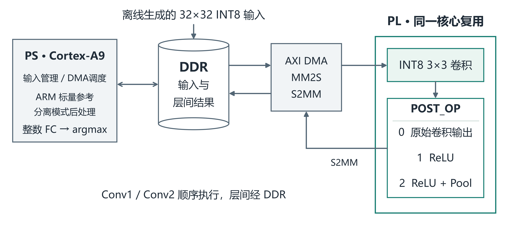

# 面向钢材缺陷分类的卷积加速器

基于 **Zynq-7020** 的 PS/PL 协同 INT8 卷积加速系统，以 NEU-CLS 钢材表面缺陷六分类为应用验证对象。PL 支持卷积、ReLU 与 2×2 最大池化的可配置融合，PS 负责输入管理、DMA 调度与整数分类头；同一硬件保留分离和融合两条路径，用于同轮消融。

**先读：[完整设计报告](report/design_report.md) · [工程源码](01_source/steel-defect-zynq7020/README.md) · [可复用 Skill](03_skill/README.md) · [大模型交互记录](report/ai_collaboration_log_a.md)**

## 核心结果

| 推理路径 | 推理链路平均延迟 | 固定测试集准确率 |
|---|---:|---:|
| 本项目 ARM 标量 `-O2` 参考 | 10.605938 ms | 217/270（80.37%） |
| PL 卷积＋PS 分离式后处理 | 6.095292 ms | 217/270（80.37%） |
| PL 卷积＋融合后处理 | **5.917320 ms** | 217/270（80.37%） |

融合路径相对本项目 ARM 参考缩短 **44.21%**，约 **1.79 倍加速**；相对同硬件同轮分离路径降低 **2.92%**。三路径逐样本预测及六类整数 logits 与冻结参考一致。

- **局部数据通路优化**：第二层卷积输出在写回前完成池化，输出由 8192 B 降至 2048 B，局部输出载荷减少 **75%**。这不是系统总 DDR 流量或延迟减少 75%。
- **正式时序与资源**：100 MHz；WNS/WHS **+0.718/+0.031 ns**；LUT 9714、FF 13069、BRAM 28、DSP 69。分离/融合模式共享同一 bitstream；48→69 DSP 是跨版本完整系统变化。
- **计时口径**：每样本测量三次取中位数，再跨 270 样本求均值。区间为已量化 DDR 输入至分类结果，包含缓存维护、DMA、等待和作业内检查，不含图像预处理及结果串口输出。

正式结果归属 2026-10-28 冻结轮次；固定 test split 共 270 张、每类 45 张。准确率对应这套模型、数据划分和预处理。

## 系统与设计要点

网络输入为单通道 32×32 INT8，两层 3×3 卷积的通道为 1→4→8，PS 分类头为 2048→6。两层顺序复用同一 PL 核心，层间经 DDR；寄存器选择卷积、卷积＋ReLU 或卷积＋ReLU＋池化。

本项目着重展示三项工程方法：同一硬件中的融合消融、整数语义与 Golden/logits 对齐、模型/载荷/硬件/固件身份追溯。其他轻量级 CNN 可参考这些方法；迁移仍需适配网络结构、量化合同和平台并重新验证。

## 评审材料导航

| 阅读内容 | 材料入口 |
|---|---|
| 背景、应用、创新及相关工作 | [设计报告第1部分](report/design_report.md) |
| 原理、系统框图、软硬件划分及接口 | [设计报告第2部分](report/design_report.md)、[硬件取舍](report/hardware_tradeoffs.md) |
| 优化过程、前后性能与资源比较 | [设计报告第3部分](report/design_report.md)、[优化数据表](report/optimization_comparison.csv) |
| 大模型提示、回答、自我纠错与工作流 | [A端真实交互Markdown](report/ai_collaboration_log_a.md)、[B端交互Markdown](report/ai_collaboration_log_b.md) |
| Skill提炼、操作步骤、有效性与边界 | [Skill总览](03_skill/README.md)、[SKILL.md](03_skill/zynq7020-cnn-dma-debug/SKILL.md) |
| 从零准备环境、构建与运行 | [复现操作索引](report/reproducibility_guide.md)、[源码REPRODUCE](01_source/steel-defect-zynq7020/REPRODUCE.md) |
| 主张依据与软件验证记录 | [证据对应表](report/claim_evidence_map.csv)、[软件核对记录](report/validation/software_review_20261104.md) |

仓库设计报告采用 Markdown，覆盖企业赛道 3.3.5.3 的内容要求，并附可浏览的图片、交互记录和复现入口。官网模板 Word 单独提交；两份报告的核心事实一致，结构和篇幅可以不同。本目录不附旧模板 Word/PDF，以免与官网最终稿混淆。

## 快速开始

1. 阅读[源码环境与依赖说明](01_source/steel-defect-zynq7020/REPRODUCE.md)，完整 Python 脚本集要求 Python 3.12。
2. **首次无需板卡**：按[Skill QUICKSTART](03_skill/zynq7020-cnn-dma-debug/QUICKSTART.md)创建三条合成刺激、生成八文件载荷并运行独立标量核对。预期输出为 `EIGHT_PAYLOADS_SCALAR_REFERENCE_PASS`，`BoardExecuted=false`、`FormalResultReproduced=false`。
3. 需要构建硬件或运行自备模型时，按[完整复现步骤](01_source/steel-defect-zynq7020/REPRODUCE.md)准备合法板级输入、匹配的工具链和BSP；接口见[八文件合同](01_source/steel-defect-zynq7020/docs/PAYLOAD_INTERFACE.md)。

## 已验证范围

已有冻结系统的正式三路径板测，以及原模型前三条、三路径共9条正确性补充记录。软件侧另有25个Python文件语法检查及18项运行检查记录，包含合成载荷正向检查和异常输入拒绝；它们不替代正式板测或真人独立试用。

公开仓库提供工程源码、生成方法与构建步骤；不含私有权重、测试图像/载荷、Golden或bit/XSA/ELF/DCP。无私有输入时可以执行合成离线检查，不能直接重放原正式270样本成绩。干净源码完整硬件重建、异机完整复现及其他模型/板卡广泛兼容性尚未完成验证，详见[验证状态](01_source/steel-defect-zynq7020/docs/VALIDATION_STATUS_R3.md)。当前是离线分类原型，尚未验证工业在线检测能力。

## 文件与许可

- `01_source/`：模型/量化、HLS、RTL、PS驱动、固件与构建/验证脚本。
- `03_skill/`：Skill入口、快速开始、寄存器/接口参考与试用表。目录编号沿用项目安排。
- `report/`：仓库设计报告、图表、真实交互Markdown和验证记录。
- [文件索引](FILE_INDEX.csv)、[SHA-256清单](SHA256SUMS.txt)、[精确白名单](RELEASE_FILE_WHITELIST.csv)、[来源许可表](SOURCE_PROVENANCE_LICENSE_REVIEW.csv)绑定当前文件集合；详细状态见[发布记录](PUBLIC_RELEASE_STATUS.json)。

团队有权授权的源码和说明按 [Apache-2.0](LICENSE) 范围发布；AMD链接脚本保留原MIT声明。第三方工具、IP、BSP和板级输入的取得与使用条件见[许可范围](01_source/steel-defect-zynq7020/LICENSE_SCOPE.md)及[第三方说明](01_source/steel-defect-zynq7020/THIRD_PARTY_NOTICES.md)。
