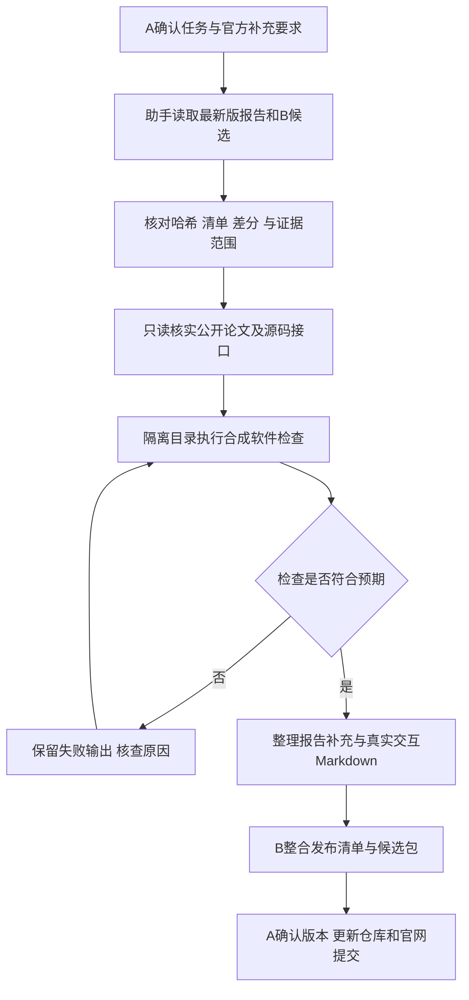

# A端大模型真实交互与纠错记录

整理日期：2026-11-04。记录对象：团队A与Codex助手在本聊天中可见的真实交互。以下“原话摘录”只引用当前可见的用户消息和助手回答，允许节选连续句段，不拼接成新的发言；“过程摘要”是本次整理，不是聊天原文。未取得平台完整导出、各条消息精确时间戳及各轮底层模型ID，因此不补写这些信息。历史工程执行日期与聊天发生时间分开记录。

本文件补充[既有团队协作摘要](ai_collaboration_log.md)，并保留模型出错、A纠正及后续核验过程。应用名称为Codex，不将应用名当作底层模型版本。公开记录已省去个人绝对路径、账号、私有模型、输入和硬件二进制。

## 1 资料范围与可追溯方法

- 来源：本聊天中可见的A与助手往返文本、A转交的官方要求截图，以及与这些交互直接关联的本地文件核对和软件执行记录。
- 查找方法：可在原聊天中搜索各案例的“用户提示原话摘录”。本文件不伪造消息ID或时间戳。
- 对话证据与实验依据分开：原话能证明发言及纠正关系；文件比较、工具输出和历史工程记录用于支持相应工程结论。两者不能互相替代。
- 本次新增验证仅为软件检查。未运行训练、HLS、Vivado、ARM固件编译、板测、正式270样本或性能测试。另一使用者的真人独立试用仍未完成。

## 2 案例一 纠正对Skill复核状态的过早判断

### 用户提示原话摘录

> 解释一下我们的可复用SKILL有哪些？在参赛想要拿到更好的名次的前提下，有没有可以增加的点

### 模型回答原话摘录

> 另外，当前主文档仍写着“Skill本身待C技术复核”；如果 C 后来已经复核，应根据实际复核记录更新状态，否则报告里不要称它已完成独立技术验证。

### 用户追问原话摘录

> 1.当前主文档仍写着“Skill本身待C技术复核”‘是什么意思？我们提交上去的源码/github仓库里面有待复核的内容么？2.我没有编写skill，你能不能把那三项完成（还是C来完成？

### 模型纠正原话摘录

> 更正我上一条：**C04 已对绑定版本的 Skill 六文件完成静态与技术复核**，结论是 `PASS_STATIC_AND_TECHNICAL_REVIEW`，所以目前不缺这项复核。

### 纠错轨迹与结果

过程摘要：助手第一次读取Skill入口中的旧状态后，没有先核对后续C04回执，导致用户无法区分“文件中遗留待审文字”与“复核确实没完成”。A追问后，助手核对C04复核文档及旧`SKILL.md`哈希，确认C04通过绑定的是旧六文件版本；“待C复核”是该文件仍留存的过时文字。新增快速开始、示例和试用表后形成新版本，旧哈希通过结论不能自动覆盖新内容。

形成规则：判断状态时同时核对文件内容、版本哈希和后续回执；对新候选单独记录执行者、范围和结果。本次A侧助手接手检查不能署名为C的独立复核。

工程关联：[Skill入口](../03_skill/zynq7020-cnn-dma-debug/SKILL.md)、[本次软件核对记录](validation/software_review_20261104.md)。C04原回执由团队内部留存，不在公开文件中假装提供全文。

## 3 案例二 通过追问补齐Skill的可使用入口

### 用户提示原话摘录

> 1.我决定把草案合入已提交版本。2.现在我们要提交最终版，需要B和C干什么，给我发给他们的信息。 3.现有海报是否需要更改？

### 模型回答原话摘录

> 我已按你的决定整理了**更新候选**，但没有覆盖已提交目录或 GitHub。候选包含修订后的 `SKILL.md`、快速开始、合成示例和独立试用记录表；本机合成示例已离线跑通。

### 后续用户提示原话摘录

> 我们的仓库能满足3.3.5么？

### 纠错轨迹与结果

过程摘要：A随后提供官方条款截图，明确技能目录需要README，且评价重点是他人能否复用。助手对照已提交集合后发现，已有`SKILL.md`和参考文档仍不能代替要求中的README总览。B在R2中新增`03_skill/README.md`，去掉快速开始标题的“草案”，补充根README目录对应说明并更新清单。该阶段没有把项目专用Skill宣传为跨板卡、跨任务的通用PYNQ Skill。

验证方式：A侧助手核对R2新增README、旧119项到120项的差分、相对链接及哈希；本轮又按隔离副本执行三条合成夹具生成和标量核对。软件可执行性与真人独立试用分开记录。

工程关联：[Skill总览](../03_skill/README.md)、[快速开始](../03_skill/zynq7020-cnn-dma-debug/QUICKSTART.md)、[验证记录](validation/software_review_20261104.md)。

## 4 案例三 纠正仓库报告与官网报告的提交理解

### 用户提示原话摘录

> 第一，3.3.5.3的技术报告官群老师说是放到github仓库里面的，和在官网有模板上传的不一样。第二刚刚赛道官方老师补充大模型交互记录需要用markdown记录。综合以上信息，给我最新版的可以直接发到 B、C 群里的信息

### 模型回答原话摘录

> 老师刚确认：**3.3.5.3 技术报告要放进 GitHub 仓库；官网的模板报告上传是另一项提交，二者都要完成。大模型交互记录必须用 Markdown 留存。**

### 用户进一步纠正原话摘录

> 补充官群老师刚发来的消息：仓库里面的报告不要求用官网模板，但一定要满足企业赛道的要求

### 模型更新原话摘录

> 因此，官网模板稿与仓库设计报告可以采用不同结构、不同篇幅，但核心事实、成绩和验证边界必须一致。无需为了形式强行做成完全相同的文件。

### 纠错轨迹与结果

过程摘要：助手早期建议两处报告保持同版，容易把“数据和结论一致”解释成“必须使用同一模板、同一文件”。A补充官方消息后，团队区分官网模板稿与仓库设计报告；仓库稿可补相关工作、优化汇总、Skill提炼和复现入口，并以Markdown留存大模型协作记录。官方要求来自A转交，助手没有声称自己进入官群核实。

工程关联：[仓库设计报告](design_report.md)、本文件及既有`ai_collaboration_log.md`。官网上传状态由A依据实际回执确认，本记录不代替回执。

## 5 案例四 区分真正的报告版本变化与元数据清除

### 用户提示原话摘录

> 最新版报告见这里

说明：该句取自包含本地Word路径的用户消息，个人绝对路径在公开记录中省略。

### 模型核对结果原话摘录

> 两份 DOCX 的正文、图片、表格和样式完全一致，仅清除了编辑者姓名等元数据。

### 后续模型回答原话摘录

> 另外，我刚读取的最新本地Word已把“Erro”改成“Error”，但“附：可复用Skill成果”仍是旧的三段，**还没有替换成上轮给你的新版文字**。它已经与B的R2报告产生差异，下一次交B打包时需要同步。

### 纠错轨迹与结果

过程摘要：首次比较时，A指定原件与B公开副本只有`docProps/core.xml`不同，不能因整份DOCX哈希不同就认定正文不是同版。A后续修改拼写后，原件发生真正正文变化；助手再次读取原件才更新结论。旧比较结论只适用于当时的输入字节，不能长期沿用。

形成规则：报告修改后核对内容与哈希，公开元数据处理另行说明；若保留模板PDF/DOCX与新增Markdown，清楚说明各自来源及版本，不用新Markdown掩盖旧附件状态。

## 6 案例五 将“材料大致齐全”细化为七项要求逐条核对

### 用户提示原话摘录

> github仓库里面的设计报告需要包括这些内容，现有的报告能符合标准么？

### 模型回答原话摘录

> **现有报告覆盖了主要技术内容，但按截图逐项严格核对，还需要补充。** 官网模板稿可以作为仓库设计报告的主体，仓库版再配套 Markdown 和复现文档，不必重写整份。

### 模型建议原话摘录

> ARM、分离PL、融合PL延迟可以并列；分离与融合使用同一bitstream，因此硬件资源相同。Protocol 1.0的48个DSP与Protocol 2.0的69个DSP应另列为跨版本比较，不能把增加21个DSP全部归因于融合。

### 纠错轨迹与结果

过程摘要：前期的“覆盖大部分要求”是概括判断。A提供完整七项要求后，助手逐项识别出相关工作、划分理由、优化对比汇总、Skill提炼过程以及AI交互原话的缺口，避免把“有技术报告文件”当成“报告已覆盖全部内容”。本轮据此补充设计报告章节和本记录。已有工程数值保持原统计范围，没有为填表虚构历史资源或跨模型结果。

## 7 案例六 A明确授权助手接手C任务并保留执行者身份

### 用户提示原话摘录

> 1.C那边跑不过来了，把C的活干了。2.替我（A）整理我和你的真实交互（按赛道要求：提示词、模型回答、自我纠错轨迹、智能体工作流设计（如有）

### 模型回应原话摘录

> 我来接手 C 尚未完成的报告补充和材料核对，并按“提示词、模型回答、纠错轨迹、工作流”整理这段真实对话为 Markdown。记录会区分原话与摘要；我能完成软件核对，但不会把自己的执行写成另一名真人的独立试用。

### 实际工具执行及纠错

过程摘要：助手在独立目录读取B的120项R2候选，检查25个Python文件语法和四个命令行帮助入口，并运行Skill结构验证。第一次结构验证因当前解释器缺少PyYAML失败；助手保留失败输出，仅为验证器配置已存在的PyYAML 6.0.3依赖目录后再次运行，通过。项目源码未为取得通过而修改。

随后，助手生成三条合成输入，运行兼容性载荷生成和独立标量核对，并检查默认270分支拒绝三条、拒绝覆盖、错误协议/会话锁、篡改Golden及篡改后重算哈希的情形。第二次完整执行的18项检查均符合预期；其中10项是预期拒绝，拒绝返回非零不等于测试失败。

这属于A侧助手执行的软件检查，不能改写为“C独立完成”“真人第三方试用”或“新增板测”。成功输出、环境和脚本身份见[软件验证记录](validation/software_review_20261104.md)。

## 8 实际使用的助手工作流

本记录范围内采用单个Codex助手调用文件、命令和网络读取工具的方式，没有启动多个自治子智能体。A、B、C是团队分工；C的工作由A授权本助手接手，不表示存在一个名为C的独立智能体。下图是本次已使用流程的整理，不是开发初期留存的智能体设计原稿。

失败分支实例是本次缺少PyYAML后的环境修正；它不是FPGA硬件故障。流程没有新增HLS/Vivado或板测授权。最终发布决定由A作出，助手本次未推送GitHub、未替团队发送消息、未上传竞赛系统。

## 9 尚未留存或尚未验证的部分

- 完整平台聊天导出、逐条消息精确时间戳和历史模型ID尚未补齐。本文件为真实可见对话节选与明确标注的过程摘要，不宣称完整逐字会话。
- 前期时序实验和板测的全部原始对话不在本次可见助手回答范围内，相关内容继续按既有团队摘要与工程证据说明，不能从用户历史提问反推不存在的模型回答。
- 软件结构验证、合成刺激通过与他人独立使用是不同结论；本次没有产生真人独立试用记录。
- 正式成绩仍归属2026-10-28冻结工件与270样本记录；2026-11-02三样本补测和本次2026-11-04软件检查分别标注。
