# 面向钢材缺陷分类的卷积加速器设计报告

本报告介绍作品背景与相关工作、系统原理、软硬件划分、优化过程、大模型协作、可复用Skill及复现步骤，配套提供图表、真实交互Markdown和验证入口。正式成绩对应历史冻结工件，后续软件检查单独标注；与官网模板报告保持核心事实及验证范围一致。

工程入口：[源码README](../01_source/steel-defect-zynq7020/README.md)；[完整复现步骤](../01_source/steel-defect-zynq7020/REPRODUCE.md)；[Skill总览](../03_skill/README.md)；[A端真实交互](ai_collaboration_log_a.md)；[软件检查记录](validation/software_review_20261104.md)。

## 官方要求与阅读位置

| 要求 | 本稿位置 |
|---|---|
| 背景、创新及前人工作 | 1.2、1.2.1、1.5 |
| 原理与框图 | 第2部分及图1–6 |
| 软硬件划分依据与接口 | 2.1.4、2.2及接口表 |
| 优化过程与前后性能、资源对比 | 3.2–3.5 |
| 大模型提示、回答与纠错轨迹 | 4.3及AI Markdown |
| Skill提炼、有效性和边界 | 4.4及Skill总览 |
| 从零操作步骤与验证范围 | 4.5及源码REPRODUCE.md |

## 摘要

本作品面向钢材表面缺陷六分类任务，在 Zynq-7020 上构建了 PS/PL 协同的 INT8 卷积加速系统。PL 端通过可配置后处理支持卷积、ReLU 与 2×2 最大池化融合，并在同一硬件中保留分离式路径，用于固定模型和输入条件下的同轮消融对比；PS 端负责输入管理、DMA 调度及整数分类头计算。融合路径将第二层卷积输出由 8192 B 降至 2048 B，局部输出载荷减少 75%。在项目自行划分并冻结的 NEU-CLS 270 张测试集上，ARM、分离式 PL 和融合式 PL 三条路径均正确分类 217 张，准确率为 80.37%；逐样本预测及六类整数 logits 均与冻结参考一致。融合路径延迟为 5.917320 ms，较本项目 ARM 标量 -O2 参考缩短 44.21%（约 1.79 倍加速），较同硬件同轮分离路径降低 2.92%。在 100 MHz 下，完整系统 WNS/WHS 分别为 +0.718/+0.031 ns，使用 69 个 DSP。结果展示了算子融合、整数数值对齐与工件追溯相结合的工程方法，并为符合既定接口的轻量级 CNN 迁移提供设计参考；当前实验仅验证上述固定模型与平台。延迟按每样本三次测量取中位数后，再对 270 个样本求均值，计时范围为已量化 DDR 输入至分类结果，包含缓存维护、DMA、等待和作业内检查，不含图像预处理及结果串口输出。本系统定位为离线样本分类原型，尚未验证工业在线检测能力。

## 第一部分  作品概述

### 1.1 功能与特性

系统接收32×32的INT8灰度张量，输出六类钢材表面缺陷中的预测类别。ARM标量参考、PL分离式后处理和PL融合式后处理组成三条推理路径。两条PL路径通过寄存器切换，无需更换bitstream即可消融比较。两层卷积复用同一计算核心，层间经DDR；融合路径在每层输出写回前完成对应激活或池化，PS保留整数分类头。固定测试套件同时检查预测、logits、中间结果及DMA状态；270张冻结测试样本的三路径预测与logits全部对齐。

### 1.2 应用领域

作品面向钢材表面缺陷分类的边缘计算验证，展示资源受限Zynq平台上的INT8卷积、算子融合和PS/PL分工方法。钢材表面缺陷筛查可作为产线视觉流程中的前置分类环节；在分布式架构中，本地推理也可作为减少不必要图像回传的设计方向。但本作品只验证离线输入上的本地六分类，没有测量产线吞吐、网络带宽、云端传输延迟或数据回传节省。当前使用NEU-CLS数据集[1]，由项目自行分组分层划分并冻结test270；输入为离线准备的32×32 INT8张量。可配置双路径为同类嵌入式网络的架构消融、整数对齐和DMA调试提供参考。潜在扩展包括在线表面检测，但采集、预处理、缺陷定位、外部数据泛化、功耗与长期稳定性仍需另行验证。

本作品以钢材表面缺陷六分类作为应用验证对象，正式准确率和板端性能均对应冻结的 NEU-CLS 模型、测试集及 Zynq-7020 实现。作品的可迁移价值主要体现在 INT8 卷积计算、卷积后处理融合和 PS/PL 协同的数据通路设计；当前实现并非可直接运行任意网络的通用推理平台。下表区分了源码接口所声明的参数范围与已有实验实际验证的范围。

**表1 实现范围、已有验证与迁移条件**

| 层次 | 当前实现或接口范围 | 已有验证 | 迁移到其他任务时的条件与边界 |
| --- | --- | --- | --- |
| 应用任务 | 钢材表面缺陷六分类，使用冻结的 NEU-CLS 模型与固定测试集 | 正式测试为 270 张，217/270（80.37%） | 准确率只代表该模型、该测试集和既定预处理，不代表其他材料、数据集或产线场景的准确率 |
| 分类网络 | 输入为单通道 32×32 INT8；两层 3×3 卷积，通道为 1→4→8；卷积间执行 ReLU，第二层后执行 ReLU 与 2×2 最大池化；PS 端分类头为 2048→6 | 正式板测和性能对比针对这条固定网络；原冻结模型前三条样本另有三路径兼容性补测 | 迁移模型需适配权重、量化参数、各层输出尺寸、PS 后处理及载荷合同。不同层数、算子顺序或分类头不能据现有实验直接宣称已支持 |
| 卷积计算核 | HLS 源码接口约束：批量 1–2，输入/输出通道各 1–16，H/W 各 1–32；固定 3×3 卷积、stride=1、padding 为 0 或 1 | 参数边界可由源码确认；合成接口和标量检查覆盖有限合成用例，不等于所有参数组合均经综合、实现或上板 | 超出接口上限、改变卷积核或步幅，需修改实现并重新验证。即使落在源码边界内，也需针对具体配置验证综合、时序、资源和板端行为 |
| 融合后处理 | Protocol 2.0 提供 POST_OP=0（卷积）、1（卷积+ReLU）、2（卷积+ReLU+2×2 MaxPool）；融合模式要求 zero point 为 0，池化要求输出尺寸满足偶数条件 | 正式三路径比较验证了本项目两层网络上的 legacy 与 fused 路径；补充三样本验证只作兼容性证据 | 可复用的是算子融合和可配置后处理的设计方法。其他网络的算子组合、量化约定或尺寸仍需适配与测试 |
| 数据与接口 | 固定 INT8、有符号数、NCHW/OIHW、指定重定量化和零点约束；完整分类载荷合同固定为上述两层网络 | 已有正式冻结模型记录，以及有限合成载荷的软件核对和原模型小样本补测 | 更换数据集或模型不仅是替换图片；须按合同生成权重、偏置、乘子、移位和 Golden/核对数据，并验证数值一致性。私有模型与输入不在公开仓库中 |
| 平台与性能 | 当前系统集成在 Smart Zynq SL V1.3B / Zynq-7020，PL 执行卷积，PS 管理 DMA 并完成分类后处理 | 正式时序、资源、延迟与准确率结果均绑定本次冻结硬件和固件工件 | 其他板卡需重新适配 PS/DDR/时钟/引脚、生成匹配硬件平台并验证时序。现有 5.917 ms、WNS 和资源数据不可外推为其他网络或平台的结果 |

#### 1.2.1 相关工作与本作品定位

钢材表面缺陷图像为边缘视觉分类提供了具体应用验证对象。Song和Yan的工作研究热轧钢带缺陷的纹理表示[1]；本作品使用NEU-CLS进行六分类验证，关注量化模型在PS/PL系统中的整数实现与调用链路，未验证在线采集、缺陷定位或产线部署。

在神经网络硬件实现方面，Sze等人的综述归纳了高效DNN处理中的硬件架构、算法与硬件协同以及评估指标和设计取舍[11]。这为本作品同时报告准确率、端到端调用延迟、资源和时序提供比较视角：局部算子输出减少不能直接等同于整条应用链路按相同比例加速。本文不根据该综述推断本板卡的DDR利用率或功耗。

FINN-R面向量化神经网络，提供设计空间探索和定制FPGA推理引擎生成，并在PYNQ等平台评估不同网络[12]。本作品没有使用FINN-R自动生成硬件，也不与其跨网络、跨平台的吞吐率直接排名。本作品的具体侧重是：在资源受限Zynq-7020上，用同一硬件工件切换分离与融合后处理，结合整数结果逐项核对，量化固定网络下局部输出载荷变化与完整推理调用延迟的关系。

上述文献用于定位本次报告中的研究背景和设计取舍，不将算子融合或INT8推理宣称为本项目首次提出的方法。

### 1.3 主要技术特点

目标器件为xc7z020clg484-1，PL接口时钟100 MHz。网络为两层3×3卷积（通道1→4→8、stride=1、padding=1），2×2池化后展平2048维并进行六类整数全连接。输入/权重为INT8，偏置和累加器为INT32；累加回绕，乘子与移位完成逐通道重定标，向偶数舍入后饱和到INT8。POST_OP选择原始卷积、卷积+ReLU或卷积+ReLU+Pool；两次作业复用核心，层间经DDR。参考实现与板端沿用同一整数合同，详见2.1.3；HLS与SoC接口设计参考[2,5]。

### 1.4 主要性能指标

冻结测试集270张、每类45张，三路径均217/270（80.37%）。融合链路延迟5.917320 ms，较ARM标量-O2参考缩短44.21%（约1.79倍），较同轮分离路径降低2.92%。每样本测3次取中位数，再跨样本求均值；计时为量化DDR输入至argmax，不含预处理。

**表2 三条推理路径的准确率与正式延迟**

| 指标 | ARM标量-O2 | legacyPL | fusedPL |
| --- | --- | --- | --- |
| 准确率 | 217/270 | 217/270 | 217/270 |
| 推理链路延迟 | 10.605938 ms | 6.095292 ms | 5.917320 ms |
| 相对ARM加速 | 1.00倍 | 约1.74倍 | 约1.79倍 |

### 1.5 主要创新点

①可配置融合：同一核心切换后处理模式，Conv2输出8192 B→2048 B，局部载荷减少75%。

②同工件消融：同一bitstream、权重和输入，量化融合的推理链路收益。

③验证方法：每路径270×6个整数logit逐位核对，结合中间结果、DMA/guard及工件哈希，区分模型准确率与实现一致性。

### 1.6 设计流程

数据划分与预处理冻结→训练量化及整数参考→HLS和wrapper核对→可配置融合及DMA集成→实现收敛与恢复100 MHz独立审计→锁定硬件和固件工件→三路径270样本正确性及延迟测量→独立性能剖析→报告与源码整理。早期验证与正式轮次分别留档。

## 第二部分  系统组成及功能说明

系统由离线数据与模型准备、板端三路径推理、主机日志采集和分析组成。Protocol 2.0表示支持可配置融合的接口版本；margin930为实现阶段使用9.300 ns分析周期、最终恢复10.000 ns（100 MHz）并独立复核的内部方案名称，不表示板端以107.5 MHz运行。以下结果对应该方案2026-10-28的正式记录。

### 2.1 整体介绍

上位机侧准备合法获取的数据、量化输入和冻结参考；板端以DDR中的32×32 INT8张量为输入。本文将ARM标量参考称为ARM，将PL卷积、PS后处理称为分离路径（legacyPL），将PL卷积融合后处理称为融合路径（fusedPL）。三条路径共享模型和输入；两条PL路径共享同一bitstream。PS均完成整数分类头。计时为已量化DDR输入至argmax，包含输入复制、缓存维护、DMA、PL等待和作业内检查；不含BMP读取、缩放、量化、计时后参考核对及UART输出。整体关系见图1。

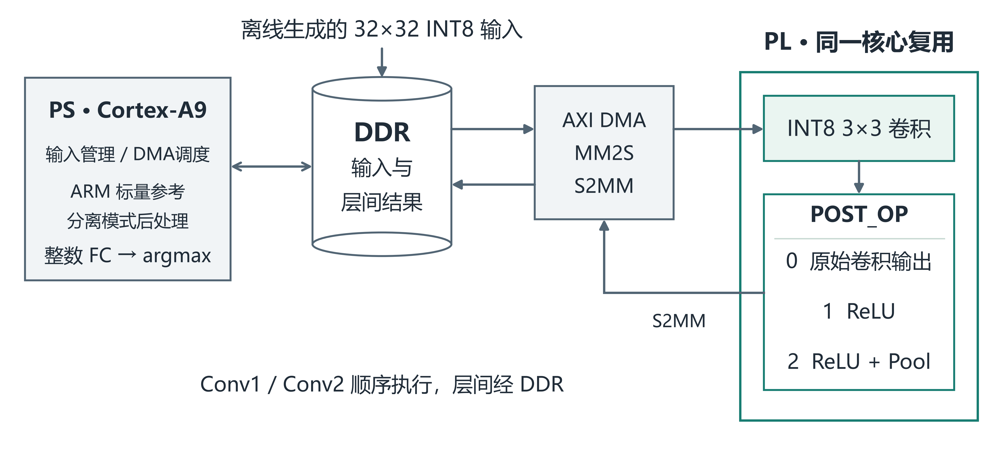

**图1 系统架构与可配置后处理路径**

注：依据既有BD和固件接口整理[7]。两层卷积顺序复用同一PL核心，层间结果仍写回DDR；图中输入为离线准备的32×32 INT8张量。

#### 2.1.1 数据划分与预处理

NEU-CLS包含六类钢材表面缺陷，共1800张200×200灰度图像[1]。项目在每个类别内部按近重复群进行分层划分。首先将图像以灰度双线性插值缩小至32×32，随后计算零均值NCC（Normalized Cross-Correlation，归一化互相关，用于衡量两张图像灰度结构的相似程度）。当两张图像的NCC不小于0.98，或其SHA-256（根据文件内容生成的256位数字指纹）完全相同时，在对应样本之间建立关联；通过一条或多条关联能够相互到达的样本构成同一连通分量，即一个近重复群。同一近重复群整体进入train、val或test中的一个划分，避免该分组判据下的近重复样本跨集出现。划分随机种子为20261018，使用NumPy的PCG64（64位置换同余伪随机数生成器）产生随机序列。train用于模型参数更新和输入标定，val用于训练阶段观察模型表现，test用于冻结模型的最终评价。

**表3 项目冻结的数据划分**

| 划分 | 样本数 | 每类数量 | 用途 |
| --- | --- | --- | --- |
| train | 1260 | 210 | 训练与输入标定 |
| val | 270 | 45 | 训练阶段验证 |
| test | 270 | 45 | 冻结模型与板端评估 |

历史审计在NCC阈值0.98下记录跨集相似对为0，完全重复文件的跨集组数为0；阈值放宽至0.95时，仍有140个跨集相似对，其中train/test间62对。阈值0.95下的相似关系仅表示图像灰度结构较为接近，不能单独证明两张图像来自同一块钢板，也不能直接等同于数据泄漏。因此，本实验只主张在所述分组判据下控制重复，不能推广为不存在任何相似样本。训练脚本在评估流程中会计算test指标；现存记录未显示test样本参与梯度更新，但不足以确认团队在全部历史模型比较和人工决策中从未参考test。故217/270应理解为本项目冻结划分上的记录结果，不声称test在整个历史开发过程中完全独立于模型选择。数据来自固定小规模划分，结果不代表跨产线泛化。

冻结预处理依次执行：读取为8位灰度图像、使用双线性插值缩放至32×32，再将像素值除以255，得到范围为0～1的归一化值 $x$。输入量化比例尺仅由冻结train划分标定。train中的归一化像素绝对值最大值为

$$
a_{\mathrm{train}}=\max |x|=1
$$

因此输入scale（量化比例尺，用于在实数和整数之间进行换算）为

$$
s_{\mathrm{in}}=\frac{a_{\mathrm{train}}}{127}=\frac{1}{127}
$$

输入zero point（零点，表示实数0对应的整数码值）为0。val和test不参与输入尺度标定。

归一化值按下式量化：

$$
q_{\mathrm{in}}=\operatorname{clip}\!\left(\operatorname{RNE}\!\left(\frac{x}{s_{\mathrm{in}}}\right),-128,127\right)
$$

RNE表示最近整数且半值向偶数舍入；本数据输入为非负灰度，实际码值为0～127。

#### 2.1.2 模型与历史训练记录

与冻结测试清单通过SHA-256关联的历史模型合同记录了训练45 epochs、batch size 64、学习率0.002、训练种子20261019、Adam优化器及纯NumPy后端等历史元数据。C的历史组件说明列出Python 3.12.7、NumPy 1.26.4和Pillow 10.4.0；历史README记录的训练命令为“python scripts/train_quantize_eval.py --epochs 45”，脚本默认batch size 64、学习率0.002、种子20261019。收到的model_v1.npz SHA-256与合同记录的权重哈希一致。交付材料未包含训练当时的环境锁定文件、pip freeze或运行日志，因此这些版本和命令有历史文档及脚本支持，但不能据此断言它们就是生成该权重时实际执行环境的完整逐项记录，也不能声称从头训练已精确复现同一权重。

#### 2.1.3 整数数值合同

软件参考模型与硬件实现采用统一的整数数值合同。输入zero point、权重zero point及padding value（卷积边界填充值）均为0，因此填充值0在整数域中仍表示真实数值0。

卷积输入和权重采用INT8，bias（偏置）和累加器采用INT32（32位有符号整数）。对输出通道 $c$，卷积累加首先计算

$$
\mathrm{acc}_{32}=\operatorname{signed32}\!\left[\left(\mathrm{bias}[c]+\sum q_{\mathrm{in}}q_w\right)\bmod 2^{32}\right]
$$

其中，模$2^{32}$ 回绕表示只保留二补数累加器的低32位。回绕不同于饱和：回绕用于准确模拟固定32位硬件累加器，饱和则用于把结果限制在目标数据类型范围内。

随后进行逐输出通道重定标：

$$
q_{\mathrm{out}}=\operatorname{sat}_{\mathrm{INT8}}\!\left(\operatorname{RNE}_{\mathrm{shift}}(\mathrm{acc}_{32}\times M[c],\mathrm{shift}[c])\right)
$$

RNE_shift的shift=0分支直接返回乘积；shift>0时，先算术右移得到q，计算被移出的非负余数r；r大于半值或等于半值且q为奇数时，q加1。该规则同时适用于正负数，不用浮点近似代替整数舍入。M的有效范围为0..2³¹−1，shift为0..62；软件参数分别存为int32_t和uint8_t，有效范围不等于存储位宽。

**表4 主要算子的整数语义**

| 算子 | 数据与累加 | 输出规则 |
| --- | --- | --- |
| 3×3卷积 | 输入/权重INT8；bias/累加INT32 | 回绕→INT64乘M→向偶数舍入→INT8饱和 |
| ReLU | INT8 | max(q,0)，不重定标 |
| 2×2最大池化 | INT8；stride=2 | 取窗口最大值，不重定标 |
| 全连接 | INT8输入/权重；INT32 bias | 最终回绕为6个INT32 logits，不输出INT8 |
| argmax | 6个INT32 logits | 最大值并列时取最小类别索引 |

输入使用NCHW、卷积权重使用OIHW，全连接权重为[6,2048]；池化张量按C/H/W顺序展平。ReLU和Pool的整数运算保持一致，执行位置由路径决定：分离路径在PS完成，融合路径在PL分别完成Conv1+ReLU与Conv2+ReLU+Pool，分类头仍在PS。输出参考既包含卷积ReLU前张量，也包含融合后的ReLU1与Pool，避免将不同阶段的张量混作同一Golden。

#### 2.1.4 软硬件划分与数据通路取舍

卷积中的乘加具有重复计算和规则访存结构，因此由PL实现INT8卷积与可配置后处理；PS负责模型输入管理、DMA控制和结果分类，便于组织作业并保持测试流程一致。两层卷积顺序复用同一核心，使现有工程可用一套接口完成两次调用；这一选择也保留了层间DDR传输与软件调度开销，并非完全片上、跨层连续流水架构。

分类头留在PS，是当前实现选择的分工边界，减少了对PL分类模块和接口的新增集成；独立插桩记录中的PS分类头窗口约0.088087 ms，支持优先细分较大的Conv2调用块。这一补充记录不等于团队已经对“分类头放PS或PL”的所有方案做过系统比较，也不证明当前划分全局最优。

ReLU和池化适合在PL卷积输出后就地执行，故通过POST_OP选择是否融合。Conv2在写回DDR前完成2×2池化，将输出从8192 B降至2048 B；同一bitstream保留分离路径，可在固定模型和输入下比较执行位置变化。为控制集成范围，本版保留DDR中间特征和既有DMA作业方式；更进一步的跨层片上缓冲、双缓冲或流水重叠应另行实现与验证。

PS分类头的0.088087 ms是独立插桩后的观察，不能回填为设计时已掌握的定量决策依据。专用PL分类头、双核和跨层流式方案尚无同口径对照，不将当前划分称为穷举比较后的最优方案。

| 选择 | 已实现的结构或行为 | 资源和实现复杂度取舍 | 证据及尚未比较的范围 |
|---|---|---|---|
| 卷积放PL | 两层卷积由同一INT8 3×3核心执行，配置后经DMA输入/输出 | 将规则计算映射为硬件，同时承担核、桥接、缓存维护及DMA控制成本 | PUB_MAIN、PUB_TOPOLOGY；正式三路径只能评价本实现，不能代表最优CPU实现或所有加速架构 |
| 分类头留PS | 六个INT32分类得分及argmax由PS软件计算，包含在推理计时内 | 保留易核对的整数实现，不增加独立FC硬件及其传输接口；仍消耗PS执行时间 | PUB_OPS；未测专用PL分类头。独立Profiling的FC块为0.088087 ms，是事后观察，不能回填为当时已量化的决策依据 |
| 两层复用一个核 | 完成Conv1后重新配置，同一核继续执行Conv2 | 避免为两层分别维护一套核心与控制连接；两层不能以两个独立核重叠执行 | PUB_MAIN、PUB_TOPOLOGY；没有双核资源/延迟对照，不能给出相对双核节省百分比 |
| 层间经DDR | Conv1结果回到内存，再作为Conv2输入 | 保留清晰的作业边界和中间结果核对入口；增加搬运、缓存及作业启动成本 | PUB_DMA；未实现并比较跨层直连，未测DDR饱和度 |
| 可切换融合后处理 | 分离路径两层POST_OP=0；融合路径Conv1=1、Conv2=2 | 同一bitstream支持模式对照；融合减少特定输出载荷，但并未取消DDR层间交换 | PUB_MAIN、PUB_REGISTERS；模式切换不改变已实现硬件资源，不能将两模式当作两份不同面积的实现 |

以上依据现有实现和记录整理；证据编号见[输入基线来源索引](source_index_b120.csv)，完整取舍与复现边界见[补充说明](hardware_tradeoffs.md)。

### 2.2 硬件系统介绍

#### 2.2.1 硬件整体介绍

系统使用Smart Zynq SL开发板，目标器件为xc7z020clg484-1。PS提供DDR、UART和AXI控制，PL集成AXI DMA、流接口wrapper及融合卷积逻辑，接口时钟100 MHz。GP0配置控制寄存器，MM2S经HP0读取DDR，S2MM经HP1写回DDR。系统关系见图2，关键接口见表5；AXI与DMA设计参考[5,6]。

#### 2.2.2 机械设计介绍

作品使用现成开发板、供电和调试线缆，团队完成板级连接、PS/DDR配置核对及系统集成。硬件工作集中于PL计算逻辑、AXI接口和软硬件协同，未设计自定义PCB或机械外壳。

#### 2.2.3 电路与PL模块介绍

AXI-Stream ingress接收作业包并核对长度、TKEEP及TLAST，权重、偏置和输入映射到片上存储；卷积核心完成INT8运算和整数重定标，后处理由POST_OP配置。第一层选择ReLU，第二层选择ReLU与2×2池化。egress将结果封装为流，经S2MM写回DDR。两层复用同一核心并分两次作业调用，层间仍经DDR；融合范围是单层卷积及后处理。通俗地说，分离路径把卷积结果返回PS，再由PS执行ReLU或池化；融合路径由PL在输出前完成对应后处理。融合没有消除整个网络的DDR往返；Conv2后接池化时，输出张量由8×32×32降至8×16×16。

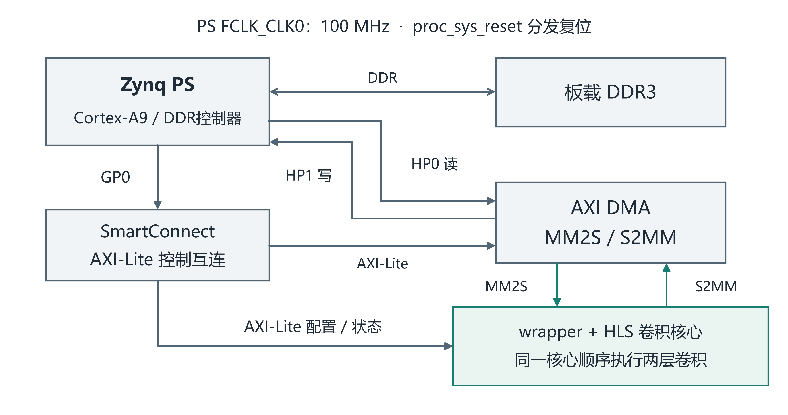

**图2 硬件系统与关键接口**

**表5 PL与PS的关键接口**

| 接口 | 方向与格式 | 作用及约束 |
| --- | --- | --- |
| aclk / aresetn | 100 MHz / 低有效复位 | AXI控制、DMA及wrapper同域连接 |
| AXI4-Lite控制 | PS→PL；32位数据、12位局部地址 | 卷积形状、POST_OP、状态与诊断 |
| AXI4-Stream输入 | MM2S→ingress；32位TDATA、4位TKEEP | 作业参数与INT8输入；含VALID/READY/LAST |
| AXI4-Stream输出 | egress→S2MM；32位TDATA、4位TKEEP | 输出特征；按POST_OP改变接收长度 |
| DMA作业 | simple mode；单次TX/RX≤16383 B | 本模型两层TX分别1096 / 4456 B |
| DDR缓冲区 | 输入、作业包、两层中间结果、分类输出 | TX/RX 64 B对齐，前后guard检查 |

卷积控制与状态寄存器摘要见表6。

**表6 卷积控制与状态寄存器摘要**

| 偏移 | 属性 | 主要含义 |
| --- | --- | --- |
| 0x00 | W | CONTROL命令值：0 无操作；1 START；2 ABORT；4 清done；8 清error；12 同时清done/error。其余值非法，不支持任意按位OR。 |
| 0x04 / 0x08 | R / R及W1C | 状态与done；错误状态及按位清除 |
| 0x10–0x28 | R/W | 依次N、Cin、Cout、H、W、padding、zero point |
| 0x2C / 0x30 | R | 预期TX / RX字节数；软件启动前核对 |
| 0x34 / 0x38 | R/W / R | watchdog周期阈值 / HLS返回状态 |
| 0x40–0x84 | R | 64位起止周期、输入/输出阻塞与活动周期计数 |
| 0x88 / 0x8C / 0x90 | R | 协议0x00020000、能力0x00030102、布局1 |
| 0x94 | R/W | POST_OP：0卷积；1卷积+ReLU；2卷积+ReLU+Pool |

注：偏移相对于卷积控制基址0x40000000；DMA控制基址为0x40400000。形状和POST_OP在空闲状态配置，软件回读后再启动。作业包按权重、INT32偏置、INT32乘子、逐通道移位量、INT8输入顺序组织，并按协议进行4 B对齐；输出长度由模式计算，不沿用分离路径的缓冲区长度。具体布局以packet_v1及冻结RTL为准。 CONTROL仅接受0（无操作）、1（START）、2（ABORT）、4（清done）、8（清error）和12（同时清done/error）；其他非零组合非法。

Conv2回写由8×32×32降至8×16×16 INT8，单样本输出少6144 B，见表7和图3。75%由张量尺寸计算，只描述Conv2输出载荷；不能等同为总DDR流量、DDR带宽占用或整体延迟下降75%。

**表7 Conv2回写张量与输出载荷**

| Conv2模式 | 回写张量 | 输出载荷 |
| --- | --- | --- |
| 分离 POST_OP=0 | 8×32×32 INT8 | 8192 B |
| 融合 POST_OP=2 | 8×16×16 INT8 | 2048 B |

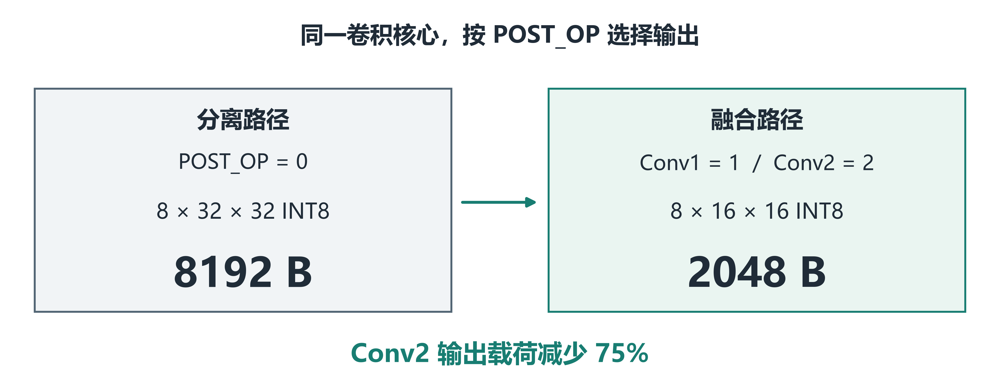

**图3 可配置后处理与Conv2输出载荷变化**

### 2.3 软件系统介绍

#### 2.3.1 软件整体介绍

PC端脚本核验输入与工件、采集串口并分析历史日志；板端standalone程序包含三路径推理、DMA驱动、缓存维护、计时和安全检查。测试先初始化并核对协议，再执行三路径冷缓存首推理和预热，随后各路径按索引0..269执行准确率pass；性能phase每样本重复3次，并按索引和重复号轮换三路径顺序，减小固定顺序影响。采集后主机停止双核的动作不在推理计时内，流程见图4。图4末端表示主机对各阶段已记录结果的汇总；每次推理的计时与计时后数值核对顺序见图5。

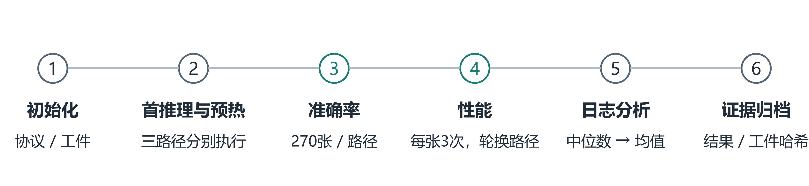

**图4 Protocol 2.0固定测试套件与证据采集流程**

#### 2.3.2 软件各模块介绍

infer按模式完成两层卷积、后处理、PS整数全连接与argmax。evaluate在每次计时开始前排空上一条UART发送，再在infer前后读计时器，随后核对预测、logits、阶段FNV和规定中间结果，最后输出本条UART记录，见图5。run_job(index, actual_input, post_op)按模式计算expected_rx_bytes，写入并回读0x94，核对流长度，先启动S2MM再启动CNN和MM2S。缓存维护、轮询、字节数及guard检查均计入推理时间；失败保存上下文并退出，不自动重试，见图6。

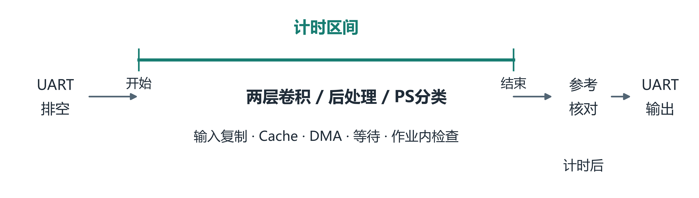

**图5 evaluate成功推理的计时与参考核对边界**

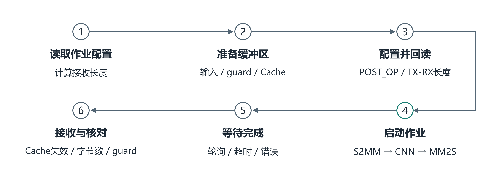

**图6 DMA卷积作业与动态接收长度**

## 第三部分  完成情况及性能参数

作品已完成可配置融合硬件、三路径板端推理及冻结270样本的正确性和延迟测量。以下正式性能、资源和时序对应2026-10-28已接受的Protocol 2.0工件及板测；独立插桩轮次另行标注。结论与记录关系见表8。

**表8 主要结论与证据对应关系**

| 结论 | 对应记录 | 范围 |
| --- | --- | --- |
| 时序与资源 | 恢复100 MHz的post-route独立审计 | 完整系统 |
| 准确率与正式时延 | 2026-10-28三路径270样本聚合报告 | 正式结果 |
| 补充性能剖析 | 独立插桩记录与聚合报告 | 不替代正式时延 |
| 实物形态 | 2026-10-31用户新拍照片 | 照片不证明测试轮次 |

### 3.1 整体完成情况与真实照片

系统实物及调试连接见图7。

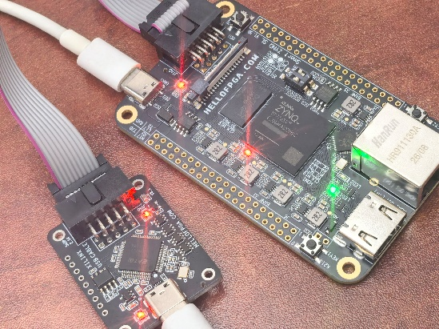

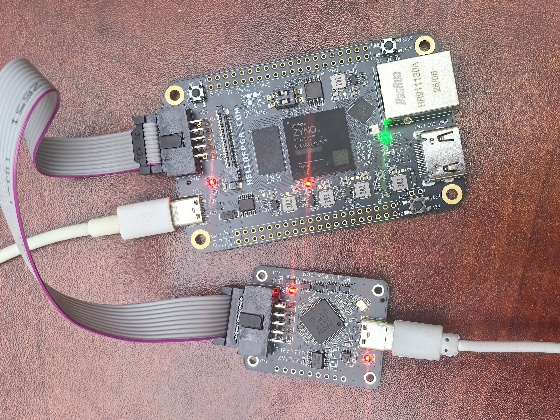

**图7 Smart Zynq SL V1.3B实物及连接：左为斜视近景，右为俯视全貌（2026-10-31实拍）**

### 3.2 工程成果

#### 3.2.1 机械成果

完成现成开发板、供电及调试线缆的系统连接，实物见图7；不包含自研机械结构。

#### 3.2.2 电路与硬件成果

100 MHz完整系统完成布局布线与板测，post-route WNS/WHS为+0.718/+0.031 ns，TNS/THS为0/0，DRC Error为0；实现和时序方法参考[3,4]。资源按xc7z020clg484-1的已存利用率报告统计，见表9。9.300 ns属于实现阶段的收紧条件，正式验收恢复为10.000 ns并独立复核。

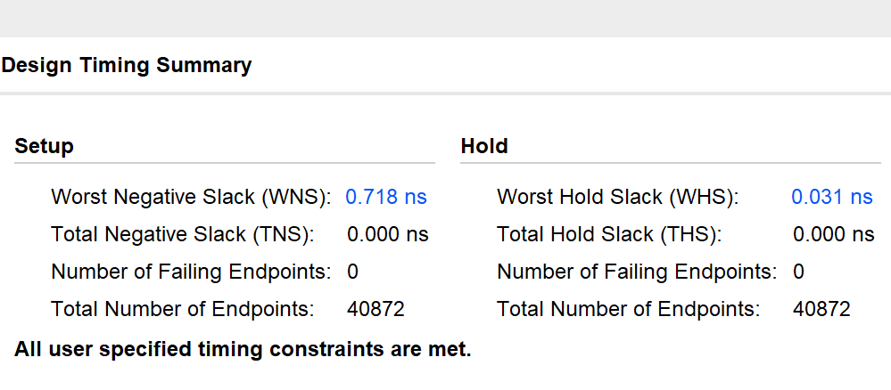

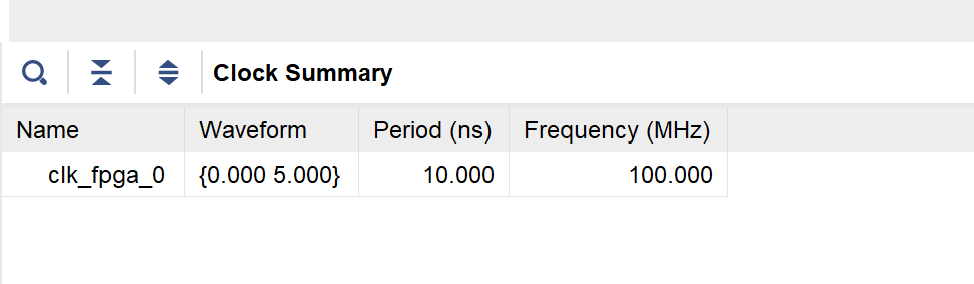

**图8 基于正式冻结DCP的Vivado时序与时钟摘要**

注：截图用于展示Setup/Hold与Clock Summary；DRC结论仍引用正式报告，本次未重新运行DRC。

来源：2026-11-04基于正式冻结DCP的补充分析截图，时序与2026-10-28正式报告核对一致[7]；DRC Error=0及83项Warning、2项Advisory仍引用原正式drc.rpt。

**表9 100 MHz完整系统的布局布线后资源**

| 资源 | 使用量 | 器件总量 | 占比 |
| --- | --- | --- | --- |
| LUT | 9714 | 53200 | 18.26% |
| FF | 13069 | 106400 | 12.28% |
| BRAM tile | 28 | 140 | 20.00% |
| DSP48E1 | 69 | 220 | 31.36% |

Protocol 2.0完整系统相对Protocol 1.0的DSP由48增至69，即增加21个（43.75%）。这是跨版本完整系统的资源变化；同一Protocol 2.0 bitstream切换模式的2.92%延迟差才是同工件消融结果。两种比较的变量范围不同，不能将21个DSP全部归因于融合，或据此计算单一融合算子的资源效率。

#### 3.2.3 软件成果

板端程序形成共享模型、输入和统计规则的三路径推理套件。驱动实现缓存维护、动态包长、完成状态、超时和guard检查；日志记录模式、样本索引、重复号、ticks、预测、logits及阶段摘要。主机分析将初始化、冷缓存、准确率和性能阶段分别统计，按工件身份关联硬件与固件，避免将历史轮次或不同统计量混合。

工程源码包含模型准备、整数参考、HLS核心、RTL桥接、板端驱动与分析工具。使用冻结权重和输入重放推理，与从头训练同一权重是不同的复现目标。R3用户载荷入口已完成独立离线核对、实际固件C算法核对和ARM编译，并于2026-11-02在原冻结硬件上完成原模型前三条输入的三路径正确性补充验证（见3.3.3）；这些记录不替代正式270样本成绩，也不证明其他模型已完成上板验证。便携入口尚未完成从HLS至整板的全链路重建或异机构建验证；工程重建仍需按配套说明取得第三方工具、板级配置与合法数据资源。

### 3.3 特性与量化结果

#### 3.3.1 测试条件与统计方法

正式推理以DDR中的已量化输入开始，至PS完成argmax结束；输入复制、缓存维护、两次DMA作业、PL执行、轮询、作业内安全检查和分类头均在内。图像读取/解码、缩放和量化在测量前完成；每次计时开始前排空上一条UART发送，预测和参考值核对及本条日志输出在计时后进行。UART排空等待与日志发送均不计入推理时间。该指标称推理链路延迟，不包含采集到显示的完整应用链路。

**表10 正式性能测量条件**

| 项目 | 条件与依据 |
| --- | --- |
| 计算平台 | Cortex-A9 standalone；PS配置约666.67 MHz，PL 100 MHz；配置值并非频率实测 |
| 编译器 | 正式构建存档：GCC 13.3.0（arm-xilinx-eabi-gcc） |
| 主要构建选项 | -DSDT -mcpu=cortex-a9 -mfpu=vfpv3 -mfloat-abi=hard -O2 -g3 -Wall -Wextra -Werror -U__clang__；使用BSP Xilinx.spec与链接脚本 |
| 计时器 | xiltimer / XTime_GetTime，读数前后DSB/ISB；记录TimerHz=333333343，按BSP频率换算 |
| 缓存与准备 | 正式ELF启动段反汇编显示启用L1指令/数据Cache、MMU及L2的设置；DMA前后显式维护Cache。本轮未新增运行时状态读回 |
| 重复与顺序 | 每路径270样本×3次=810条性能记录；三路径交替顺序；准确率pass单独执行 |
| 正式主统计量 | 每个样本先取3次中位数，再对270个样本中位数求算术均值 |

注：编译选项来自正式build_record，编译器版本来自随包compiler_version记录；工程绝对路径不写入报告。计时器和CPU配置未作外部校准，Cache启用配置依据正式ELF启动段反汇编，DMA缓存维护依据正式驱动代码；未独立读回运行时Cache状态。ARM结果仅代表本项目标量-O2实现，不代表NEON、厂商库或其他优化软件的最佳性能。

#### 3.3.2 三路径延迟与分布

主统计量为ARM 10.605938 ms、分离路径6.095292 ms、融合路径5.917320 ms，与表2一致。融合相对ARM缩短44.21%，相对同工件分离路径缩短2.92%；后者的绝对差约0.177971 ms。表11由既有正式记录离线计算，未新增测量。

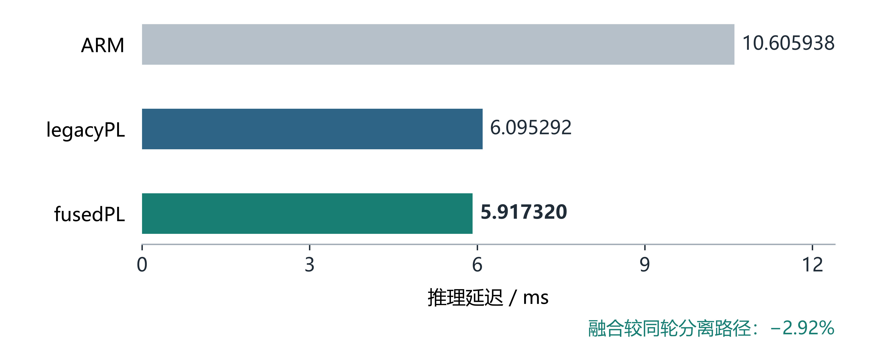

**图9 正式270样本三路径推理链路延迟对照**

来源：2026-10-28 full270_run01/analysis/summary.json及对应工件绑定记录[7]。每样本3次取中位数，再对270个中位数求均值。

**表11 270个样本中位数的延迟分布（单位：ms）**

| 路径 | 最小值 | P50 | P95 | P99 | 最大值 |
| --- | --- | --- | --- | --- | --- |
| ARM | 10.036029 | 10.608721 | 10.999627 | 11.048724 | 11.100249 |
| legacyPL | 6.090738 | 6.095433 | 6.097629 | 6.098587 | 6.098811 |
| fusedPL | 5.915346 | 5.917329 | 5.918357 | 5.918993 | 5.919456 |

分位数在270个样本中位数排序后采用线性插值：位置h=(n−1)p，在相邻次序统计量之间插值；最小/最大值也取自这270个中位数，而非全部810次原始测量。该分布描述本测试套件中的样本差异，不能替代长时间运行、实时截止期或功耗测试。

#### 3.3.3 数值一致性与分类表现

准确率与实现一致性分别评价。三路径各有270次准确率推理，每次对6个INT32 logits执行memcmp并比较预测，即每路径1620个整数输出；全部与冻结参考逐位一致，不设置容差。准确率pass对ReLU1的4096 B和Pool的2048 B逐字节核对，ARM和分离路径另核对两层ReLU前卷积输出。其他阶段还检查ReLU1、Pool和六个小端INT32 logits的三项FNV-1a32。哈希摘要检查与逐字节检查的范围不同，不能互相替代。

三条路径均正确分类217/270，准确率为80.37%；错分样本集合相同，全部270个样本的六维INT32 logits均与冻结参考一致，未观察到硬件路径新增的分类差异。该事实不能证明错分的具体成因。类别顺序为Cr龟裂、In夹杂、Pa斑块、PS麻点表面、RS轧入氧化皮、Sc划痕；类别PS与处理器PS含义不同。表12和图10展示同一冻结混淆矩阵。

**表12 冻结测试集各类分类指标**

| 类别 | 正确/样本 | Precision/% | Recall/% | F1/% |
| --- | --- | --- | --- | --- |
| Cr 龟裂 | 40/45 | 85.11 | 88.89 | 86.96 |
| In 夹杂 | 30/45 | 85.71 | 66.67 | 75.00 |
| Pa 斑块 | 45/45 | 88.24 | 100.00 | 93.75 |
| PS 麻点表面 | 34/45 | 79.07 | 75.56 | 77.27 |
| RS 轧入氧化皮 | 43/45 | 63.24 | 95.56 | 76.11 |
| Sc 划痕 | 25/45 | 96.15 | 55.56 | 70.42 |
| 宏平均 | — | 82.92 | 80.37 | 79.92 |

Precision=TP/(TP+FP)，Recall=TP/(TP+FN)，F1为二者调和平均；宏平均为六类算术平均。以上指标由既有混淆矩阵离线计算，未新增实验。RS召回较高但Precision为63.24%，Sc召回55.56%，反映类别表现不均衡，不能仅以总体准确率代替逐类评估。

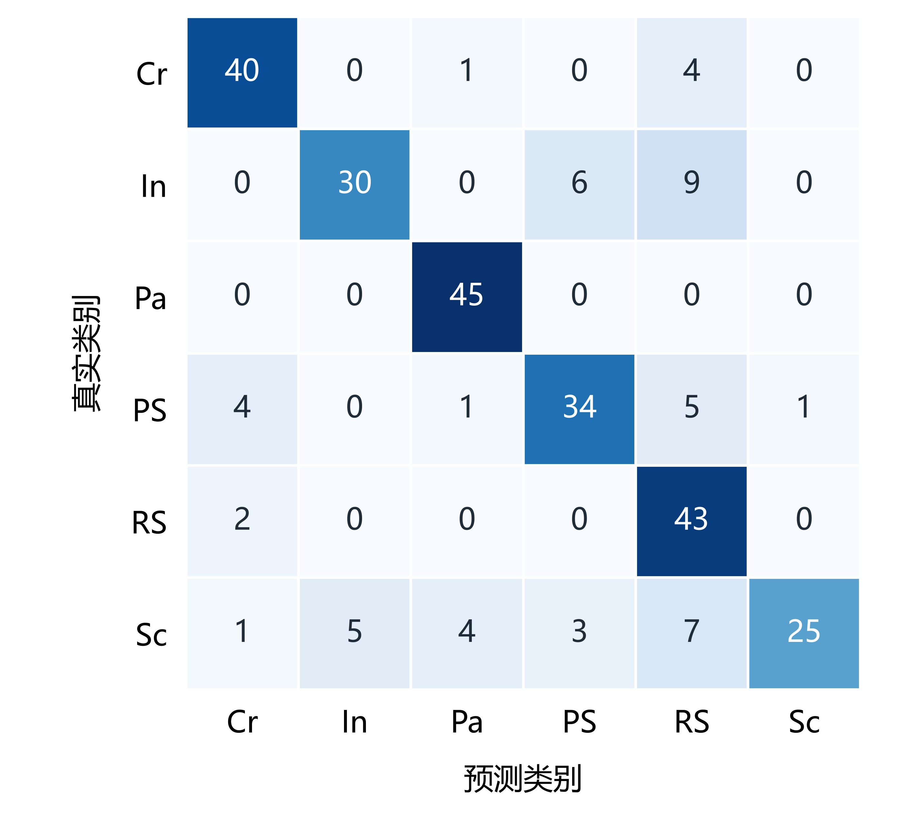

**图10 冻结测试集270样本混淆矩阵（三路径一致）**

补充兼容性上板验证（2026-11-02）：在既有锁定bit/XSA/PS初始化和匹配BSP上，使用R3专用用户兼容性ELF，对此前冻结模型及原顺序输入0、1、2各执行ARM、legacyPL、fusedPL一次，共9条正确性记录。预测、六个INT32 logits、三阶段FNV及适用的中间结果检查一致；DMA与guard检查通过，固件输出唯一PASS标记。该轮证明这三条既有输入在兼容性入口上的小样本上板正确性，不是准确率实验、性能测试或正式270复测，不应表述为“3/3准确”或新的217/270结果。正式工件和历史日志的8项SHA-256核对未变；本轮未运行HLS、综合、实现或改变正式结果。可选的运行后JTAG寄存器快照因XSDB内存映射限制未取得，不作为本次证据。原始UART/JTAG日志与设备身份保存在私有证据包。

#### 3.3.4 两轮原始日志验证摘录

以下为日志逐行摘录，非终端截图；各段从原日志不连续选行，保留原文。日期、原文件和行号可由来源索引及LINE_SOURCE_MAP.csv回查[10]。

正式270样本轮次，2026-10-28。来源：full270_run01/serial_suite.log，原日志第4、3252行。

```text
META,0000010E,00000003,0000000013DE435F
```

```text
PASS: NEU_FULL270_FUSED_POSTOP_V2
```

三样本兼容性补测，2026-11-02。来源：session01/serial_private.log，原日志第2、4、14行。

```text
SUITE=USER_MODEL_COMPATIBILITY_NOT_FORMAL
```

```text
SAMPLES=00000003
```

```text
PASS: USER_MODEL_COMPATIBILITY_NOT_FORMAL
```

正式日志中的V2为历史套件标识，按原文保留。PASS表示对应套件的检查通过；217/270及5.917320 ms仍以正式汇总记录和既定统计口径为依据。

### 3.4 Profiling补充分析

独立插桩轮次显示，Conv2主机调用块高于Conv1与PS分类头，可作为后续细分缓存、DMA、PL执行和轮询的优先对象。该轮融合路径算术平均为5.931708 ms，固件和统计方式不同于正式5.917320 ms；表13仅用于补充分析，不替代正式成绩。

**表13 独立插桩轮次的观察窗口**

| 观测区间 | 聚合均值 | 解释边界 |
| --- | --- | --- |
| Conv1主机调用块 | 1.399457 ms | 含缓存、DMA、PL执行、轮询与收尾 |
| Conv2主机调用块 | 4.412575 ms | 含缓存、DMA、PL执行、轮询与收尾 |
| PS全连接分类头 | 0.088087 ms | PS侧整数分类处理 |
| 两层末输入至core_done | 4.845960 ms | 嵌套窗口；含启动/状态过渡，不可重复相加 |

表13的三个主机侧区间合计5.900119 ms。其余0.031589 ms包括输入复制与软件准备0.001715 ms、Conv1结果处理0.010111 ms、Conv2结果处理0.011577 ms、argmax 0.000270 ms、插桩硬件快照读回0.007621 ms及边界残差0.000295 ms，完整分解见[Profiling附录](../01_source/steel-defect-zynq7020/reports/PROFILING_APPENDIX.md)。主机调用块内部仍混合缓存维护、DMA、PL执行、轮询与收尾，不能进一步认定为纯DMA或纯PL计算耗时。4.845960 ms属于嵌套观察窗口，不能与上述调用块再次相加。该独立插桩轮次的5.931708 ms不替代正式5.917320 ms。局部输出载荷下降75%而正式整链路延迟下降2.92%，说明局部收益需放在完整调用链中评价；未测DDR利用率或CPU可调度任务量，不能据此证明DDR饱和或PS调度压力下降。

### 3.5 优化过程与性能资源对照

#### 3.5.1 同轮三路径性能和同工件模式对比

| 比较项 | ARM标量-O2 | Protocol 2.0 分离PL | Protocol 2.0 融合PL |
|---|---|---|---|
| 正式平均推理链路延迟 | 10.605938 ms | 6.095292 ms | 5.917320 ms |
| 正确分类数 | 217/270 | 217/270 | 217/270 |
| 与冻结参考的预测及整数logits | 一致 | 一致 | 一致 |
| Conv2传回PS的输出特征 | ARM路径在PS内处理，不作PL回写比较 | 8192 B | 2048 B |
| PL硬件身份 | ARM软件参考；不形成独立PL资源对照 | 同一Protocol 2.0 bitstream | 同一Protocol 2.0 bitstream |
| 该bitstream资源 | 不作为ARM软件开销 | LUT 9714、FF 13069、BRAM tile 28、DSP 69 | LUT 9714、FF 13069、BRAM tile 28、DSP 69 |
| 正式时钟及时序 | PS配置约666.67 MHz；非外部频率实测 | PL100 MHz，WNS/WHS +0.718/+0.031 ns | 同一完整硬件的时钟与时序 |

正式统计量为每样本三次测量取中位数，再对270个样本中位数求均值。融合较本项目ARM参考延迟缩短44.21%（约1.79倍加速）；较同bitstream分离模式缩短2.92%，绝对差约0.177971 ms。两种PL模式共享同一硬件，切换模式不改变已占用的逻辑资源。上述结果不能与“移除融合逻辑后的另一份硬件”混同。

#### 3.5.2 跨版本资源变化

| 比较项 | 历史Protocol 1.0完整系统 | Protocol 2.0完整系统 | 比较范围 |
|---|---|---|---|
| LUT / FF / BRAM tile / DSP | 8652 / 11557 / 28 / 48 | 9714 / 13069 / 28 / 69 | 两个完整系统，非两种寄存器模式 |
| WNS / WHS（ns） | +0.503 / +0.016 | +0.718 / +0.031 | 各自100 MHz实现报告；TNS/THS均0/0 |
| ARM标量参考（ms） | 10.850700 | 10.605938 | 不同轮次，不用于融合单变量比较 |
| PL推理链路（ms） | PS+PL 6.083702 | 分离6.095292；融合5.917320 | 仅P2内部两路径形成同轮融合对照 |
| 实现报告 / 板测日期 | 2026-10-17 / 2026-10-22 | 2026-10-28 / 2026-10-28 | 历史记录，非本次重测 |

本次B补充找回旧资源和时序记录，并说明旧bit/XSA与旧板测的哈希绑定已核对；A侧找到了同哈希旧板测汇总和绑定记录，但未在本次本地材料中取得与索引哈希相同的旧资源/时序原件，这两项沿用B提供并核对的摘要。来源身份与公开/私有范围见[source_index_b120.csv](source_index_b120.csv)中P1、P2项。新增21个DSP（43.75%）属于跨版本完整系统变化，不能全部归因于融合，也不能与2.92%直接相除评价融合模块性价比。正式融合收益仍用P2同一bitstream、同轮套件比较。其他优化尝试若缺完整工件绑定，不补造资源或延迟曲线。

#### 3.5.3 时序收敛方法与验收边界

融合候选曾未达到团队WNS≥+0.500 ns门槛。团队按限定范围在实现阶段使用9.300 ns分析周期，结束后恢复10.000 ns，并用独立工具进程审计实际100 MHz条件；已接受工件的WNS/WHS为+0.718/+0.031 ns，TNS/THS=0，DRC Error=0。9.300 ns是实现收敛条件，不是板端实际运行频率。由于本汇总未逐一列出所有失败候选的同口径报告，不给出未经绑定的改善幅度，也不把本方法推广为对任意设计必然有效。

| 阶段 | 分析周期 | 既有WNS / WHS | 用途 |
|---|---|---|---|
| 收紧实现条件 | 9.300 ns | +0.018 / +0.031 ns | 实现阶段实验条件，非板端107.5 MHz运行证据 |
| 恢复并独立审计 | 10.000 ns | +0.718 / +0.031 ns | 正式100 MHz验收，TNS/THS 0/0、DRC Error 0 |

两个约束下的slack差不代表额外推理加速。原始记录按私有身份留档；本次只核对和补充文档。

## 第四部分  总结

本作品完成了同一硬件内可切换的卷积融合与分离路径、三路径整数推理和270样本板测。最有价值的工程结论是：通过固定模型、输入与工件，能够将局部输出载荷减少75%与整条推理链路仅降低2.92%的收益放在同一口径下审视，避免用局部算子收益代替系统收益。融合路径达到5.917320 ms，且预测和logits与参考一致。完整系统使用69个DSP并满足100 MHz时序；跨版本资源增量不能全部归因于融合。分类表现、原训练环境留存、外部泛化及长时间运行仍有限制，成果定位为软硬件协同与架构验证原型。

### 4.1 可扩展之处

从应用范围看，本作品的硬件方法不局限于钢材表面缺陷分类。卷积核心通过寄存器配置批量、输入／输出通道数、特征图尺寸、填充及后处理模式；当前卷积核固定为3×3、步幅为1，具体上限见表1。整数数据通路与固定接口也为迁移到其他小型 INT8 卷积网络提供了基础。迁移时仍需按目标网络重新准备权重与输入载荷，并核对量化参数、层间尺寸和数值结果；当前实现已针对既定模型和 32×32 输入完成验证，尚不能据此宣称可直接支持任意网络或任意输入尺寸。

后续可沿两条路径扩展：一是完善模型与载荷生成、接口配置及逐层数值核对流程，降低更换模型时的集成成本；二是细分 Conv2 主机调用中的缓存维护、DMA、PL 执行和轮询开销，并在保持相同测量口径的条件下评估优化效果。若面向其他缺陷类别或应用场景，还需使用相应数据重新训练或选择模型，并独立完成精度、资源、时序及板端验证。

### 4.2 心得体会

在项目联调中，我们逐渐认识到，硬件加速效果需要结合时序、资源和端到端测量综合判断，不能只看计算单元的吞吐能力。大模型帮助我们整理排查步骤、核对接口和归纳证据，但最终的设计取舍仍由团队依据工具报告和板端记录作出。以下是两个真实的小插曲（依据已有对话及工程记录整理[8]）：

#### 4.2.1 单变量时序优化与独立审计

问题与人工决策：早期融合候选的WNS未达到+0.500 ns验收门槛。老师提出调整约束后，我们决定保留C0源码，在独立目录将实现阶段周期收紧至9.300 ns，为工具提供更严格的时序收敛目标，结束后恢复10.000 ns进行独立审计。

AI协助：大模型协助整理隔离目录、输入身份核对和审计步骤。团队随后核对正式WNS/WHS为+0.718/+0.031 ns，DRC Error=0。9.300 ns是实现阶段的收敛约束，最终在10.000 ns下审计并以100 MHz运行。

#### 4.2.2 将载荷接口核对推进到三样本上板验证

问题与人工决策：验证用户载荷接口时，我们重点担心载荷和既有硬件是否匹配。团队决定不重评模型，选用原冻结的0、1、2号样本，在独立目录和专用兼容性ELF下核对接口闭环。

AI协助：大模型协助将载荷生成、标量参考、固件C核对、ARM编译及工件身份检查串成检查清单。团队逐项核对专用PASS和三路径共9条正确性记录，以及logits、FNV、DMA和guard结果，确认了这三个既有样本的接口闭环；该结果不替代正式270样本成绩。

调试步骤见配套Skill。

### 4.3 大模型协作与纠错记录

大模型辅助定位文件、整理检查步骤、比较清单和组织报告，团队保留输入、设计取舍和发布决定。真实交互记录采用Markdown：本轮A与助手的提示、回答摘录、状态误判后的纠正及实际工具工作流见[ai_collaboration_log_a.md](ai_collaboration_log_a.md)；较早工程协作见[ai_collaboration_log.md](ai_collaboration_log.md)。缺少的平台导出、逐条时间戳和模型版本明确列为未留存，不补写成逐字会话。

本轮没有启动多个自治子智能体；采用单个Codex助手调用工具。A授权助手接手C的软件核对，不代表C本人已经独立复核，也不能替代未参与编写者的真人试用。本次软件检查的执行范围、正负用例和成功输出见[validation/software_review_20261104.md](validation/software_review_20261104.md)。

B另外提供了三组逐字交互节选：截图类型误导的自我纠正、按C固件纠正FC累加位宽，以及补回DIFF附件并绑定新哈希。见[B交互记录](ai_collaboration_log_b.md)及[10条节选索引](b_ai_quote_records.csv)。这些节选由B提供，A侧校验节选哈希/长度，未独立调取B平台消息。A、B记录分别署明来源；未取得C逐字会话，不补造。A侧本轮采用单助手调用工具，没有多智能体工作流记录；团队分工不等同于多智能体。

### 4.4 Skill提炼与复用边界

| 已有问题或观察 | 提炼为可复用规则 | 已有验证与本次检查 | 适用边界 |
|---|---|---|---|
| 实现收紧条件与板端正式时钟容易混淆 | 实现阶段与正式约束分开；恢复约束后独立审计 | 历史100 MHz审计和报告明确9.300/10.000 ns用途；本次只核对记录和说明 | 未重新运行实现；不承诺另一设计同样收敛 |
| 输入布局、整数回绕、舍入及Golden阶段必须一致 | 固化八文件合同，并用独立标量计算核对 | 历史载荷检查；本次三条合成刺激生成/核对通过，篡改Golden重算哈希仍被拒绝 | 合成刺激不是训练模型，也不产生分类准确率 |
| 同名硬件、固件或载荷不能证明兼容 | 绑定模型、样本顺序、载荷、bit/XSA、BSP、ELF身份；检查协议与能力 | 原R3三样本兼容性补测按身份锁执行；本次错误协议和会话锁拒绝检查通过 | 本次没有重新ARM编译或板测，其他模型/板卡仍待适配 |
| DMA操作需考虑缓存、长度、guard和超时 | 固化S2MM先准备、CNN/MM2S启动、Cache维护和失败停止流程 | 源码静态核对与历史小样本DMA/guard记录 | 这是检查规则，不据此声称历史发生过所有故障类型 |
| 可选JTAG寄存器快照被内存映射限制阻止 | 如实保留失败；区分固件内部检查与外部快照 | 历史报告明确未取得快照；本次未强制访问 | 不能用已输出PASS反推外部寄存器读取成功 |
| 使用者需要从入口定位步骤和预期结果 | 提供README、快速开始、合成示例及试用表 | R2已补入口与链接；本次软件试跑通过 | 另一使用者真人独立试用仍未完成 |

Skill的适用范围是Smart Zynq SL V1.3B、Protocol 2.0及固定32×32 INT8、1→4→8两层卷积和PS2048→6分类头。跨任务可参考接口合同、身份绑定、数值检查和故障留存的方法；它尚不是跨板卡、跨网络验证的通用PYNQ Skill。

### 4.5 复现说明

完整步骤、示例命令、输入/输出与失败条件见[复现操作索引](reproducibility_guide.md)。其中硬件和板测命令是未在本轮执行的配方；A侧本轮已执行的软件检查见[独立记录](validation/software_review_20261104.md)。

完整命令、合法板级输入获取方式和验收门槛见源码[REPRODUCE.md](../01_source/steel-defect-zynq7020/REPRODUCE.md)。其他使用者应按顺序执行以下阶段；“有步骤”与“团队已验证这一阶段”分开陈述。

| 阶段 | 操作入口 | 输入及输出 | 当前验证范围 |
|---|---|---|---|
| 环境准备 | 源码REPRODUCE的依赖节与`requirements-validation-win-py312.lock` | Python3.12、NumPy/Pillow等验证依赖；需要时另备Vivado/Vitis2025.2、ARM编译器 | 历史环境及本次软件环境分别记录，不当作原始训练环境导出 |
| 无板卡首次检查 | Skill QUICKSTART；`make_interface_fixture.py`、`generate_user_payloads.py --compatibility`、`verify_user_payloads.py` | 自生成合成整数刺激，输出载荷和核对结果 | 本次实际执行通过，不是板测 |
| 合法板级输入 | `prepare_board_inputs.py`；`docs/BOARD_INPUT_ACQUISITION.md` | 用户自行取得的供应商参考归档，生成本地PS参数及身份锁 | 历史导入/规范化和有限BD校验有记录；不捆绑受限归档 |
| HLS至整板实现 | `hardware/hls_source/rebuild_fused_hls.py`、`scripts/rebuild_margin930.py` | 公开源码与合法板级输入，生成新RTL、实现报告及通过门槛后的bit/XSA | 干净源码到新完整系统的全链路尚未执行验证 |
| XSA至BSP | `scripts/create_standalone_bsp.py` | 新XSA生成匹配的standalone BSP | 新BSP入口尚未验证；历史编译使用既有匹配BSP |
| 用户模型及专用固件 | 八文件合同、`build_user_firmware.py` | 用户合法自备NPZ/JSON、INT8输入、CSV、匹配BSP，输出专用ELF | 原R3有限载荷/C算法/ARM编译有记录；本轮未重新编译 |
| 现有兼容硬件运行 | `lock_compatible_hardware.py`、`run_user_compatibility.py` | 当前会话授权、匹配硬件与固件、实际UART/JTAG | 原模型前三条有历史补测；本次无板端执行 |

公开源码不含私有模型、输入、Golden、bit/XSA/ELF/DCP。合成刺激可自生成，原正式270样本成绩不能仅凭这个无私有输入的仓库立即重放。若要从头训练或复现原模型，需要另行合法取得数据并按合同准备；现有历史训练参数不证明必然得到同一权重。新硬件、异机重建及其他模型兼容性须实际执行后再更新验证状态。

## 第五部分  参考文献

[1] SONG K, YAN Y. A noise robust method based on completed local binary patterns for hot-rolled steel strip surface defects[J]. Applied Surface Science, 2013, 285: 858–864.

[2] AMD. Vitis High-Level Synthesis User Guide: UG1399[Z].

[3] AMD. Vivado Design Suite User Guide Implementation: UG904[Z].

[4] AMD. UltraFast Design Methodology Guide for the Vivado Design Suite: UG949[Z].

[5] AMD. Zynq-7000 SoC Technical Reference Manual: UG585[Z].

[6] AMD. AXI DMA LogiCORE IP Product Guide: PG021[Z].

[7] 项目团队. Protocol 2.0正式时序 资源与三路径板测记录[Z]. 正式记录2026-10-28，图表整理2026-11-02；来源索引SOURCE_CATALOG.csv及SOURCE_INDEX.csv，原始证据私有留档.

[8] 项目团队. [A端大模型真实交互与纠错记录](ai_collaboration_log_a.md)及[B端逐字节选与纠错](ai_collaboration_log_b.md)、[既有团队协作摘要](ai_collaboration_log.md)，2026-11-04整理。前者含可见原话节选与纠错链，后者为历史摘要；均非平台完整导出。

[9] 项目团队. [Zynq-7020 AXI-DMA与卷积引擎端到端调试](../03_skill/README.md)，含SKILL、快速开始和references。当前软件执行与真人试用范围分别记录。

[10] 项目团队. 正式270样本与三样本兼容性UART日志摘录及行号映射。原始记录2026-10-28、2026-11-02；报告3.3.4为非连续逐行摘录，原始日志和来源索引由团队私有留档，不把未置入本仓库的02_uart_excerpts目录写作公开附件。


[11] SZE V, CHEN Y H, YANG T J, EMER J. Efficient Processing of Deep Neural Networks: A Tutorial and Survey. arXiv:1703.09039, 2017. [公开论文摘要与元数据](https://arxiv.org/abs/1703.09039)。本轮已核对标题、作者、日期及摘要；使用范围为架构、协同设计和评估取舍的背景，不据此引述未核对的具体图表数值。

[12] BLOTT M, PREUSSER T, FRASER N, GAMBARDELLA G, O'BRIEN K, UMUROGLU Y. FINN-R: An End-to-End Deep-Learning Framework for Fast Exploration of Quantized Neural Networks. arXiv:1809.04570, 2018. [公开论文摘要与元数据](https://arxiv.org/abs/1809.04570)。本轮已核对标题、作者、日期及摘要；使用范围为量化网络FPGA工具链与定制推理引擎定位。
